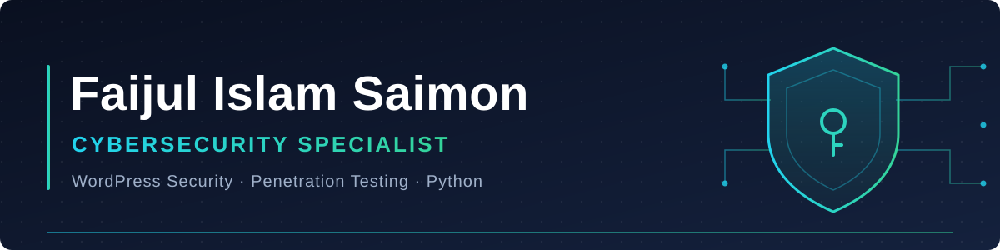

 

 

### About

I'm a cybersecurity specialist. Most of my client work is WordPress security, and I also do penetration testing and write Python. I like learning, and I spend a lot of my time studying new techniques in security.

 

### WordPress security

I help site owners who have been hacked or need to move their site safely.

| Malware removal | Malware cleanup | Site migration |
|:---|:---|:---|
| Finding and removing malicious code from hacked WordPress sites. | Cleaning up infected sites and returning them to a safe, working state. | Moving a site to a new host or domain safely. |

 

### Focus

  

### Tools

 

 

### Contact

The best way to reach me is on [LinkedIn](https://linkedin.com/in/faijsec) or through my [website](https://www.faijsec.com). For WordPress work, you can also find me on [Fiverr](https://www.fiverr.com/faijsec).
